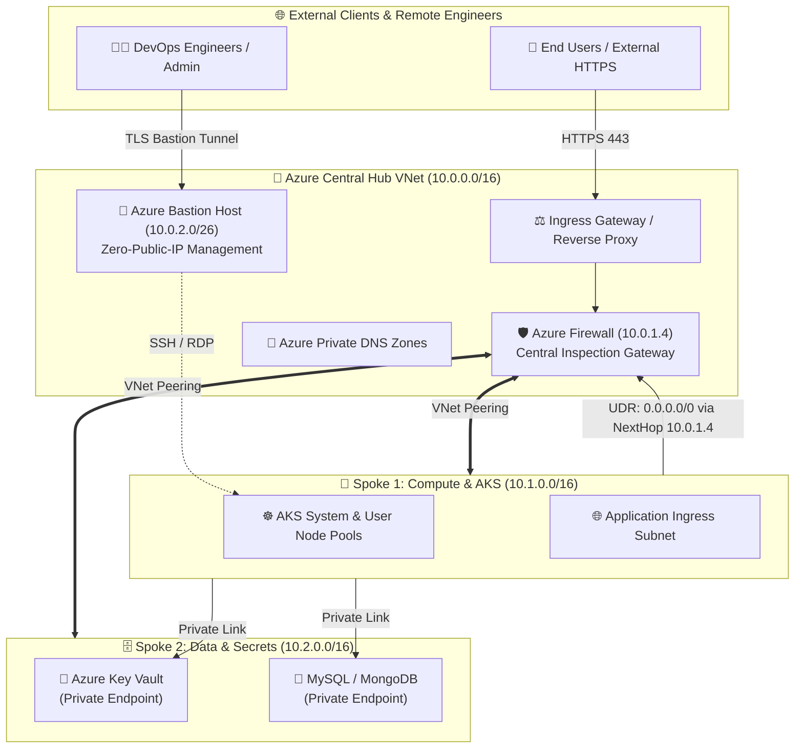

# 🏛️ Enterprise Azure Landing Zone & Hub-Spoke Network Topology

[](https://www.terraform.io)
[](https://azure.microsoft.com)
[](https://www.checkov.io)
[](LICENSE)

An enterprise-grade, production-hardened **Microsoft Cloud Adoption Framework (CAF)** compliant Azure Landing Zone architecture. Implemented using **modular Terraform** with advanced `for_each` maps, state locking, centralized inspection, zero-trust network segmentation, and automated CI/CD validation.

---

## 🌟 Architectural Highlights

* 🏢 **Central Hub Virtual Network (`10.0.0.0/16`)**: Hosts centralized ingress/egress inspection via **Azure Firewall**, secure administrative jump-box access via **Azure Bastion**, and management services.
* 🚀 **Application Spoke VNet (`10.1.0.0/16`)**: Dedicated microservices and containerized application workloads (**Azure Kubernetes Service - AKS**).
* 🗄️ **Data & Platform Spoke VNet (`10.2.0.0/16`)**: Isolated database workloads, **Azure Key Vault**, and **Azure Private Endpoints**.
* 🔄 **Bidirectional VNet Peering**: Low-latency, non-transitive peering between Hub and all Spokes provisioned dynamically via `for_each` maps.
* 🛡️ **Forced Egress Routing**: Custom User-Defined Routes (UDR) routing all `0.0.0.0/0` outbound traffic from spoke subnets through the Azure Firewall private IP.
* 📡 **Private DNS Integration**: Private DNS zones for AKS, Key Vault, and Storage accounts dynamically linked across all VNets.

---

## 📐 Network Topology & Traffic Flow



---

## 📂 Modular Repository Structure

```
azure-landing-zone-hub-spoke-terraform/
├── .github/
│   └── workflows/
│       └── terraform-ci.yml         # CI Pipeline: fmt, tflint, checkov, validate
├── environments/
│   ├── dev/
│   │   ├── main.tf                  # Environment root composition
│   │   ├── variables.tf             # Input variables & map definitions
│   │   ├── terraform.tfvars         # Dev environment CIDRs & config
│   │   ├── outputs.tf               # Hub/Spoke IDs, Firewall IP, Bastion FQDN
│   │   └── versions.tf              # Provider constraints & Azure Blob backend
│   └── prod/                        # Production environment configuration
├── modules/
│   ├── hub_network/                 # Hub VNet, subnets & management NSGs
│   │   ├── main.tf                  # Dynamic for_each subnet provisioning
│   │   ├── variables.tf
│   │   └── outputs.tf
│   ├── spoke_network/               # Spoke VNets, dynamic subnets & Route Tables
│   │   ├── main.tf                  # Route table mapping 0.0.0.0/0 -> Firewall
│   │   ├── variables.tf
│   │   └── outputs.tf
│   ├── vnet_peering/                # Bidirectional VNet peering
│   │   ├── main.tf                  # Dynamic peering loop using for_each
│   │   ├── variables.tf
│   │   └── outputs.tf
│   ├── azure_firewall/              # Azure Firewall Standard/Premium & Policies
│   │   ├── main.tf                  # Network & Application rule collections
│   │   ├── variables.tf
│   │   └── outputs.tf
│   ├── azure_bastion/               # Azure Bastion Host (Standard SKU)
│   │   ├── main.tf
│   │   ├── variables.tf
│   │   └── outputs.tf
│   └── private_dns/                 # Private DNS Zones & cross-VNet links
│       ├── main.tf
│       ├── variables.tf
│       └── outputs.tf
├── .checkov.yml                     # Checkov IaC security policy
├── .gitignore                       # Terraform state & credential exclusions
└── README.md                        # Project documentation
```

---

## 🚀 Quickstart & Deployment

### 1. Prerequisites
* Azure CLI (`az login` with Contributor/Owner rights)
* Terraform `>= 1.5.0`
* TFLint & Checkov for local linting and policy scanning

### 2. Configure Remote State (Azure Blob Storage)
Create an encrypted Azure Storage Account with Blob versioning and Lease locking:
```bash
az group create --name rg-terraform-state-mgmt --location eastus2
az storage account create --name sttfstatedevglobal --resource-group rg-terraform-state-mgmt --sku Standard_LRS --encryption-services blob
az storage container create --name tfstate --account-name sttfstatedevglobal
```

### 3. Initialize & Deploy Development Environment
```bash
cd environments/dev

# Initialize providers and modules
terraform init

# Validate syntax and run policy checks
terraform validate

# Review deployment execution plan
terraform plan -out=tfplan

# Apply infrastructure
terraform apply tfplan
```

---

## 🛡️ DevSecOps & Shift-Left Compliance

Every commit and pull request runs automated checks in GitHub Actions:
* **Terraform Formatting**: `terraform fmt -check -recursive`
* **Static Analysis**: `tflint --recursive`
* **IaC Security Policy**: `checkov -d . --framework terraform`
  - Validates zero open inbound `0.0.0.0/0` SSH/RDP rules.
  - Ensures Azure Firewall has DNS proxy enabled.
  - Enforces public IP standard SKU allocation.

---

## 👩‍💻 Author
**Anjali Sain**  
*DevOps & Cloud Platform Engineer*  
* [LinkedIn](https://www.linkedin.com/in/anjali-sain-devops) • [GitHub](https://github.com/sainanjali) • [Email](mailto:sainanjali083@gmail.com)
